# Speedy

**A self-hosted, real-time messaging platform with security controls documented to the level an
engineering review would ask for.**

Speedy is a complete chat application — direct and group conversations, media and file sharing,
delivery and read receipts, presence, pinning, password-locked conversations, two-factor sign-in and
a moderation queue — built on a small, auditable stack: Node.js, Socket.IO, SQLite and vanilla ES
modules. No build pipeline, no ORM, no framework churn.

It is also **yours to host**: one command on a VPS, a Compose file with TLS, an env-driven auth
policy, and no managed service in the dependency chain.

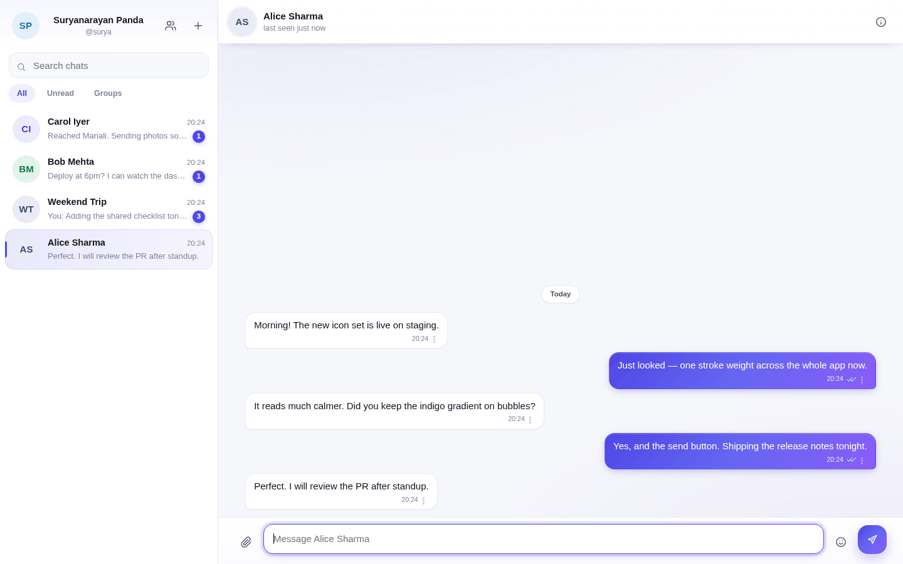

---

## Contents

- [Screenshots](#screenshots)
- [Capabilities](#capabilities)
- [Self-hosting](#self-hosting)
- [Architecture](#architecture)
- [Security controls](#security-controls)
- [Getting started](#getting-started)
- [Configuration](#configuration)
- [Operations](#operations)
- [API](#api)
- [Testing](#testing)
- [Data protection and compliance](#data-protection-and-compliance)
- [Contributing](#contributing)
- [Limitations and roadmap](#limitations-and-roadmap)
- [License](#license)

---

## Screenshots

Both themes are built from the same design tokens — the layout, type scale and spacing are identical,
so switching only changes surface and ink.

### Desktop

| Screen | Light | Dark |
| --- | --- | --- |
| Sign in | 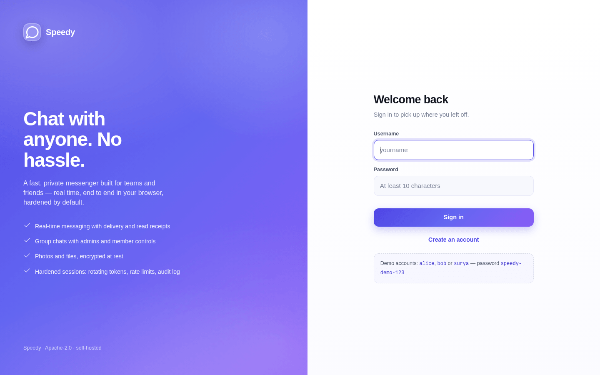 | 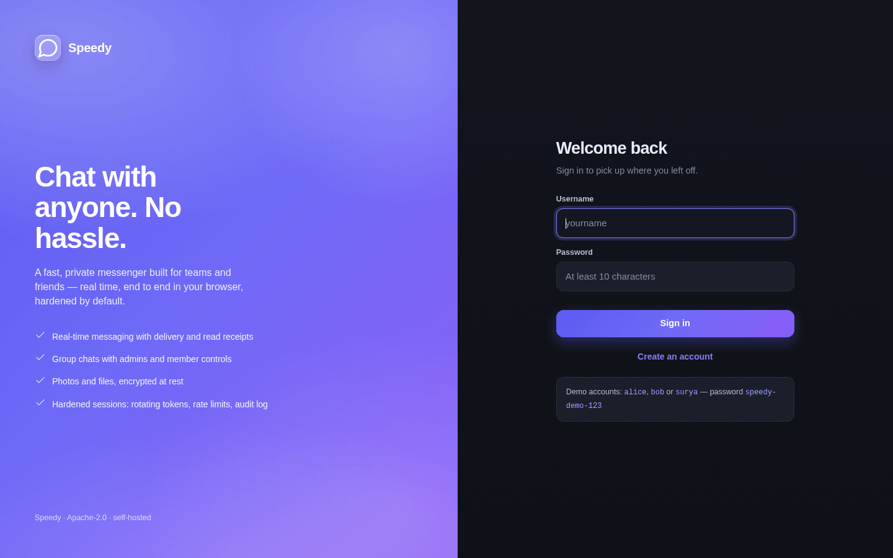 |
| Chats | 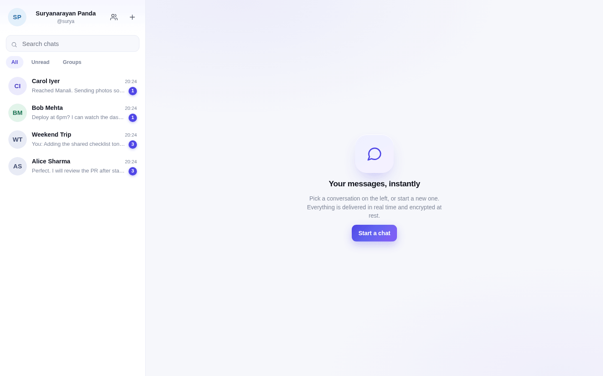 | 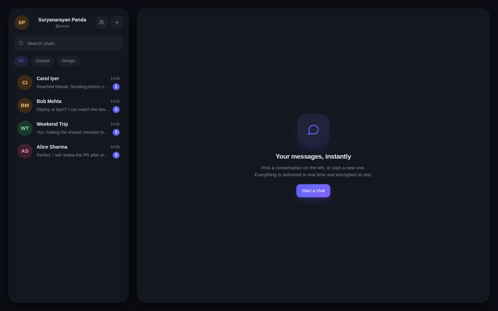 |
| Conversation |  | 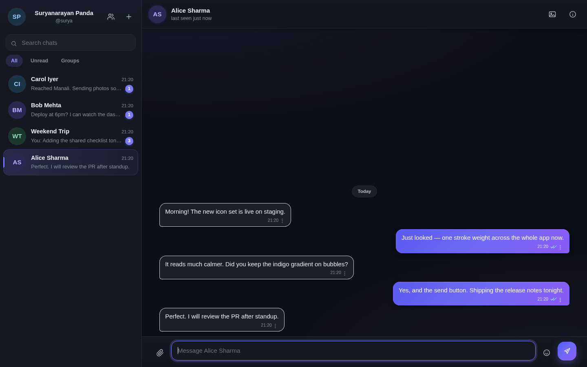 |
| Group chat | 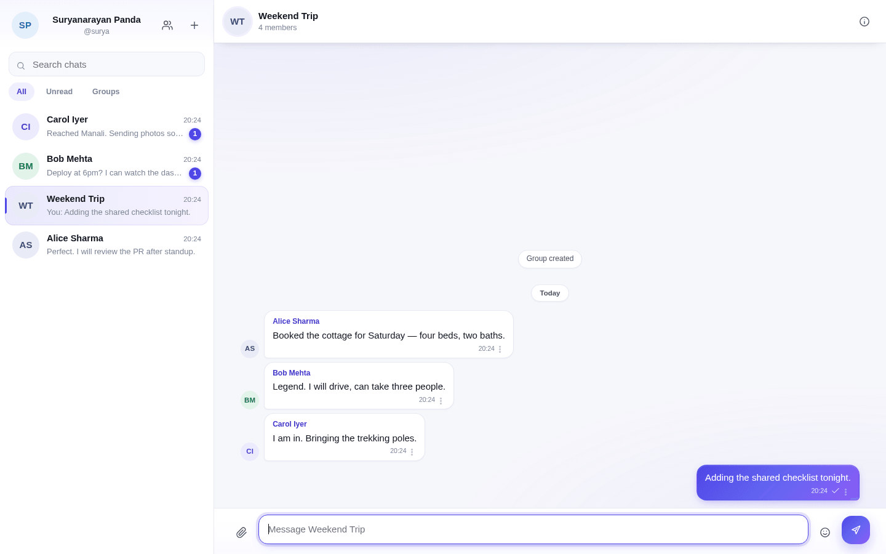 | 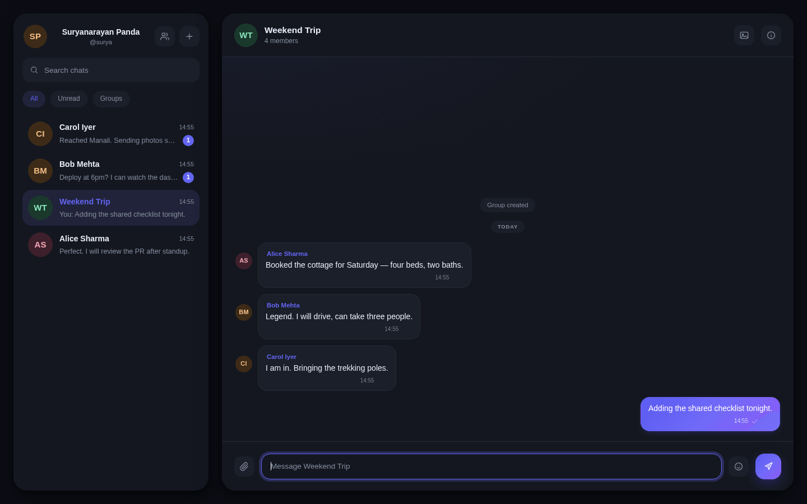 |
| Profile | 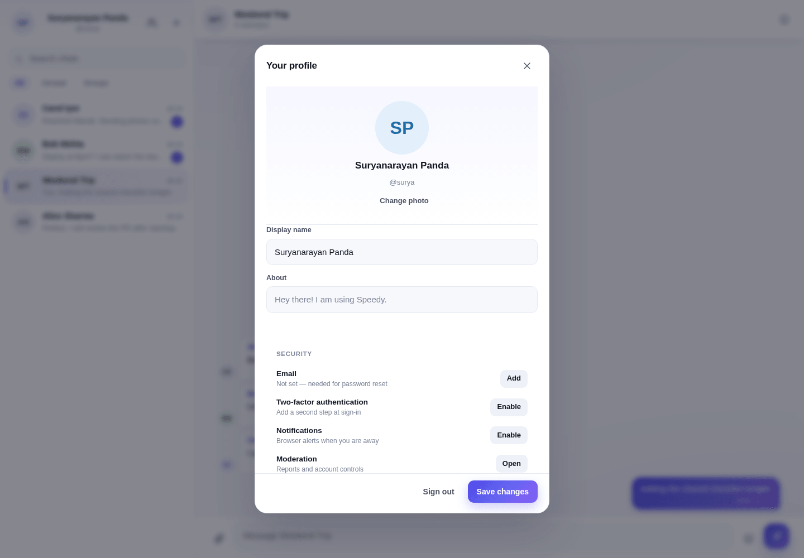 | 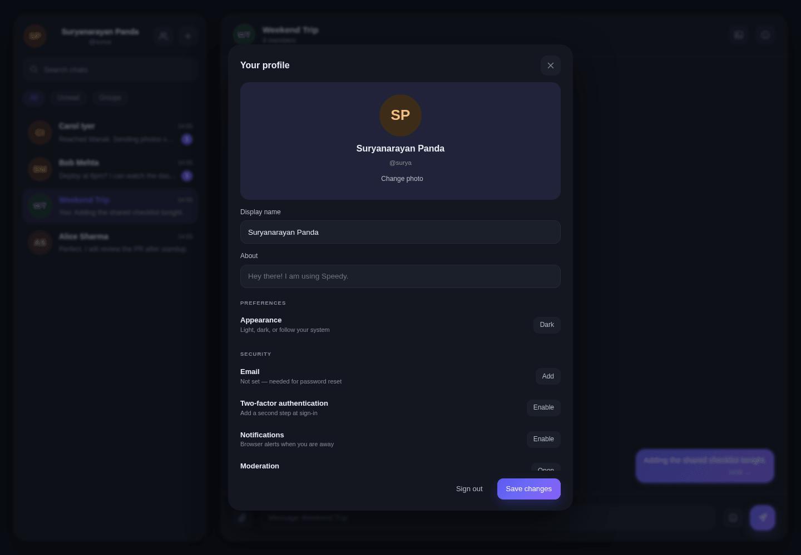 |

### Mobile

| Screen | Light | Dark |
| --- | --- | --- |
| Chats |  |  |
| Conversation | 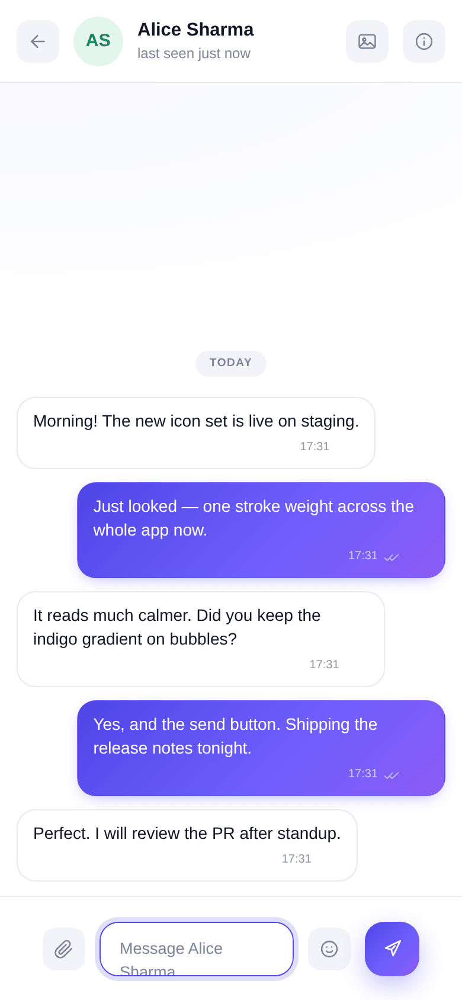 | 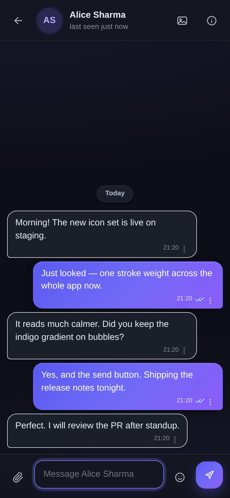 |

## Capabilities

**Messaging**
Real-time 1:1 and group conversations over WebSockets with polling fallback · message history with
cursor pagination · delivery and read receipts · typing indicators and presence · replies with
quoted context · emoji reactions · edit and delete-for-everyone · image and file attachments with
inline previews and a lightbox · in-conversation search · unread counts.

**Conversation management**
Pin conversations to the top · lock a conversation behind the account password · mute · filters
(All / Unread / Groups) · block contacts.

**Accounts, security and groups**
Username + password accounts · optional email verification and password reset · TOTP two-factor with
single-use backup codes · breached-password screening · profile with display name, about and avatar ·
group roles
(owner / admin / member) · add, remove and rename · leave with ownership transfer · session list
with per-device revocation.

**Moderation and operations**
Report a message from its menu · admin console with an open-reports queue (dismiss, remove message,
disable author) · account enable/disable · audit log with optional Slack-compatible alerting ·
Web Push notifications (VAPID) · browser-side service worker for delivery.

**Product quality**
Responsive three-card desktop layout (sidebar, conversation, contact details) and full-screen mobile
layout · light and dark themes built from the same tokens (nothing moves when you switch) · one
1.7-stroke icon set · designed in Figma first, then implemented · keyboard shortcuts · accessible markup with focus states and
reduced-motion support · optimistic sending with offline detection and retry.

## Self-hosting

```bash
git clone <your-fork-url> speedy && cd speedy
sudo ./install.sh          # Docker: generates secrets, builds, starts
```

Or with TLS and Redis in front of it:

```bash
cp .env.example .env && node scripts/setup.js --force --origin https://chat.example.com
docker compose -f docker-compose.prod.yml up -d --build
```

Without Docker: `npm ci --omit=dev && node scripts/setup.js && NODE_ENV=production npm start`, behind
Caddy or nginx. Full runbook — env matrix, systemd unit, backups, upgrades, scaling — is in
**[docs/DEPLOY.md](docs/DEPLOY.md)**.

**Auth policy is configuration, not code.** `ALLOW_REGISTRATION` closes public signups once your team
is onboarded, `MFA_POLICY` chooses off/optional/required, `REQUIRE_EMAIL_VERIFICATION` turns on
confirmation emails, `ADMIN_USERNAMES` promotes your moderators at boot, and `SMTP_*` wires up reset
mail. A clone behaves the way the operator wants without touching a source file.

## Architecture

```
Browser (vanilla ES modules, no build step)
  ├── api.js      fetch + bearer token + single-flight refresh + CSRF header
  ├── socket.js   Socket.IO client, ack-promisified
  ├── store.js    one observable state object
  └── ui/*        sidebar, chat pane, info panel, modals — DOM built with h(), text nodes only
        │
        │  HTTPS /api   +   WSS /socket.io
        ▼
Express 4 ── requestId → helmet/CSP → pino → json/cookies → origin check → rate limits → route
        │
        ├── modules/<domain>/{routes,service}.js   validation → service → SQL
        ├── realtime/io.js                         socket auth, rooms, presence, per-socket limits
        ├── realtime/bus.js                        in-process domain events (transport agnostic)
        └── db/                                    @libsql/client (SQLite, WAL) + migrations
```

Services never import Socket.IO: they publish domain events on an internal bus and the realtime layer
fans them out. The same `messages.sendMessage()` therefore serves both `POST /api/chats/:id/messages`
and the `message:send` socket event.

**Data model** — `users`, `sessions`, `chats`, `chat_members`, `messages`, `attachments`,
`message_receipts`, `reactions`, `blocks`, `audit_log`. Each chat carries a monotonic `seq` counter
incremented inside the same transaction as the insert, so pagination, read receipts and unread counts
are immune to clock skew.

## Security controls

Status legend: **Implemented** — in the codebase and covered by tests. **Partial** — present with a
stated gap. Everything in this table is enforced server-side; nothing relies on the UI hiding a
button.

### Authentication

| Control | Implementation |
| --- | --- |
| Password storage | scrypt, N=32768 / r=8 / p=1, 64-byte output, 16-byte per-user salt; parameters embedded in the hash so they can be raised later |
| Password comparison | `timingSafeEqual`; unknown usernames run a dummy derivation so response time does not reveal whether an account exists |
| Account enumeration | Identical error text and status for unknown user and wrong password |
| Brute force | Per-account lockout after 5 failures (15 min) plus per-IP rate limits on `/auth/login` and `/auth/register` (20 / 15 min, successful attempts not counted) |
| Username policy | Lower-cased, length and character limits, reserved names refused (`admin`, `root`, `support`, …) |
| Password policy | Minimum 10 characters, maximum 128, no silent truncation |
| Breached passwords | Checked against Have I Been Pwned via k-anonymity (only a 5-character SHA-1 prefix leaves the server); fails open on outage |
| Second factor | RFC 6238 TOTP (SHA-1, 6 digits, 30 s, ±1 step drift) with 10 single-use backup codes stored as SHA-256 hashes; password alone yields only a 5-minute challenge, never a session |
| Email ownership | Verification and reset links are 256-bit random tokens, stored hashed, single use, expiring (24 h / 1 h); a reset revokes every existing session |
| Registration policy | `ALLOW_REGISTRATION`, `MFA_POLICY`, `REQUIRE_EMAIL_VERIFICATION` are operator-controlled; admin roles sync from `ADMIN_USERNAMES` at boot |

### Sessions and tokens

| Control | Implementation |
| --- | --- |
| Access token | HS256 JWT, 15-minute lifetime, claims `sub` / `sid` / `role`, held in a JavaScript variable only — never `localStorage`, never a cookie |
| Refresh token | 384-bit opaque random value, stored **hashed** (SHA-256), sent in an `httpOnly`, `SameSite=Strict`, `Secure`, path-scoped cookie |
| Rotation | A new session row on every refresh, linked by `replaced_by` |
| Reuse detection | Presenting an already-rotated token revokes the entire token family and writes an audit event |
| Idle timeout | A session with no activity for 30 minutes is revoked on the next request (`SESSION_IDLE_MINUTES`) |
| Absolute lifetime | 30 days from the first login of a family, unaffected by refreshing (`SESSION_ABSOLUTE_DAYS`) |
| Immediate revocation | Every authenticated request re-checks the session row (30 s cache), so logout, "sign out everywhere", idle expiry and reuse detection take effect at once — including for live sockets |
| Device management | Users can list and revoke individual sessions; the current one is marked |
| CSRF | `SameSite=Strict` cookie + `Origin` / `Sec-Fetch-Site` checks on writes + double-submit token on `/auth/refresh` |

### Authorization

| Control | Implementation |
| --- | --- |
| Conversation access | Every read, write, search and attachment request checks `chat_members` |
| Message mutation | Edit and delete are author-only |
| Group administration | Rename, add and remove require `owner`/`admin`; role changes are `owner`-only; the owner cannot be demoted or removed |
| Attachment access | Owner, a member of a conversation where the file is used, or an avatar — never "any authenticated user" |
| Locked conversations | `423` until a password-derived, 30-minute token bound to user + chat is presented |
| Blocking | A blocked contact cannot open a direct conversation with you |

### Transport

| Control | Implementation |
| --- | --- |
| TLS | Terminated at the reverse proxy; `Secure` cookies and `upgrade-insecure-requests` in production |
| HSTS | One year, `includeSubDomains`, `preload` (production only) |
| Security headers | CSP (`default-src 'self'`, no `unsafe-inline`, no `unsafe-eval`), `X-Frame-Options: DENY`, `nosniff`, `Referrer-Policy: no-referrer`, COOP/CORP `same-origin`, `Permissions-Policy` |
| API caching | `Cache-Control: no-store` on every API response |

### Data at rest

| Control | Implementation |
| --- | --- |
| Message bodies | AES-256-GCM, key from `MESSAGE_KEY` outside the database, authenticated (tampering fails the tag rather than returning garbage) |
| Attachments | Encrypted on disk with the same AES-256-GCM key (`SPV1` container), `0600`, random names, outside the static root |
| Refresh tokens | SHA-256 hashes only |
| Backups | Encrypted payloads by construction — a stolen backup does not expose message content or files without the key |

### Input and output handling

| Control | Implementation |
| --- | --- |
| SQL injection | 100% parameterised statements; no string interpolation of user input anywhere |
| Request validation | Zod schema on every body, query string and socket payload; `422` with per-field messages |
| Size limits | 128 KB JSON, 10 MB uploads, 256 KB socket payloads, 4 000-character messages |
| XSS | User content is only ever written as text nodes; `innerHTML` is reserved for hard-coded icon constants |
| CSP | Strict policy with no `unsafe-inline`; inline styles are avoided so it can stay strict |
| Upload validation | MIME derived from magic bytes, never from the client header |
| Image handling | Every image is decoded and **re-encoded** — this strips EXIF/GPS and destroys polyglot payloads (a valid PNG with appended PHP code does not survive) |
| Filenames | Path components, control characters and reserved characters stripped; 120-character cap; stored under a random UUID |
| File serving | `Content-Type` from the sniffed type, `nosniff`, `Content-Security-Policy: default-src 'none'; sandbox`, `Content-Disposition` inline only for JPEG/PNG/GIF/WebP |
| Malware scanning | Optional ClamAV `INSTREAM` scan before a file is written; an infected upload is rejected and audited |
| SSRF | `lib/safe-fetch.js` is the only sanctioned outbound HTTP path: http/https only, no credentials in the URL, private/loopback/link-local/metadata addresses refused, DNS results re-checked (rebinding), redirects re-validated, time and size caps |

### Realtime

| Control | Implementation |
| --- | --- |
| Socket authentication | Access token required at handshake **and** the session row re-checked, so revoked sessions cannot hold a connection |
| Room authorization | Sockets join only conversations the user belongs to; joining is re-verified |
| Flood control | Per-socket token bucket (30 events / 10 s) plus per-IP HTTP limits |
| Payload validation | Same schemas as the REST path, size capped |
| Origin | WebSocket CORS pinned to `PUBLIC_ORIGIN` |

### Operations and accountability

| Control | Implementation |
| --- | --- |
| Audit log | Registration, login success/failure/lockout, refresh reuse, idle and absolute expiry, logout, session revocation, blocking, group membership changes, chat lock/unlock, account deletion — with user id, IP, user agent and timestamp |
| Logging | Structured Pino with redaction of `authorization`, `cookie`, `token`, `password`; request id echoed as `X-Request-Id` |
| Health | `GET /healthz` reports status, version, uptime and environment; `503` when the database is unreachable |
| Backups | `npm run backup` — `VACUUM INTO` snapshot + encrypted uploads + manifest with SHA-256, retention pruning, safe while the server runs |
| Restore | `npm run restore -- --from <dir>` verifies the manifest before overwriting, and refuses to clobber a live database without `--force` |
| Secrets | Required in production (the server refuses to boot without `JWT_SECRET` and `MESSAGE_KEY`); generated once with `0600` in development |
| Container | Non-root user, all capabilities dropped, `no-new-privileges`, read-only root filesystem with a writable data volume |
| Shutdown | Graceful on `SIGTERM`/`SIGINT`; uncaught exceptions are logged then exit non-zero so the supervisor restarts cleanly |
| Rate limits | 300 req/min per IP globally, 20 auth attempts / 15 min, 90 writes/min, 60 uploads/hour, 30 socket events / 10 s |
| Alerting | Audit events that matter (token replay, lockouts, malware, account deletion, moderation actions) are posted to `ALERT_WEBHOOK_URL` |
| Moderation | Any member can report a message; admins get a queue and can dismiss, delete the message or disable the author, all audited |
| CI security | GitHub Actions runs the test suite, `npm audit --audit-level=high`, a committed-secret check, and CodeQL with `security-and-quality` queries; Dependabot covers npm, actions and Docker |
| Scaling | Optional Redis adapter (`REDIS_URL`) lets several instances share socket rooms |

## Getting started

```bash
git clone <your-fork-url> speedy && cd speedy
npm install
cp .env.example .env       # optional in development — secrets are generated for you
npm run seed               # optional demo data
npm start                  # http://localhost:3000
```

Demo accounts created by `npm run seed` (password `speedy-demo-123`): `alice`, `bob`, `carol`,
`dev`, `surya`.

> Development writes generated secrets to `data/.dev-secrets.json` (mode `0600`). In production the
> server refuses to start unless `JWT_SECRET` and `MESSAGE_KEY` are set.

## Configuration

| Variable | Default | Notes |
| --- | --- | --- |
| `NODE_ENV` | `development` | `production` enables HSTS, secure cookies and required secrets |
| `PORT` | `3000` | |
| `PUBLIC_ORIGIN` | `http://localhost:$PORT` | Origin used for CORS and CSRF checks |
| `DATA_DIR` | `./data` | Database, uploads, development secrets, backups |
| `UPLOAD_DIR` | `$DATA_DIR/uploads` | Encrypted attachments |
| `JWT_SECRET` | generated in dev | **Required in production**, ≥ 32 characters |
| `MESSAGE_KEY` | generated in dev | **Required in production**, base64 of exactly 32 bytes |
| `ACCESS_TOKEN_TTL` | `900` | Access token lifetime (seconds) |
| `REFRESH_TOKEN_TTL` | `2592000` | Refresh token lifetime (seconds) |
| `SESSION_IDLE_MINUTES` | `30` | Revoke a session after this much inactivity |
| `SESSION_ABSOLUTE_DAYS` | `30` | Hard limit on a session family, refresh or not |
| `TRUST_PROXY` | `0` | Set to `1` behind nginx/Caddy/Cloudflare |
| `MAX_UPLOAD_BYTES` | `10485760` | Per-file upload limit |
| `LOG_LEVEL` | `info` | Pino level |
| `ALLOW_REGISTRATION` | `true` | Close public signups once onboarding is done |
| `MFA_POLICY` | `optional` | `off`, `optional` or `required` |
| `REQUIRE_EMAIL_VERIFICATION` | `false` | Needs `SMTP_*` |
| `ADMIN_USERNAMES` | empty | Comma-separated; promoted to admin at boot |
| `SMTP_HOST` / `SMTP_*` | empty | Password reset and verification mail; without it links are logged |
| `HIBP_ENABLED` | `true` | Breached-password screening |
| `CLAMAV_HOST` | empty | Enables upload malware scanning |
| `ALERT_WEBHOOK_URL` | empty | Slack-compatible security alerts |
| `REDIS_URL` | empty | Socket.IO adapter for multi-instance |
| `VAPID_PUBLIC_KEY` / `VAPID_PRIVATE_KEY` | empty | Web Push (`npm run vapid`) |

## Operations

**Deploy with Docker**

```bash
export JWT_SECRET=$(openssl rand -base64 48)
export MESSAGE_KEY=$(openssl rand -base64 32)
docker compose up -d --build
```

**Check what is running**

```bash
curl -s localhost:3000/healthz
# {"status":"ok","version":"1.2.0","uptime":42,"env":"production"}
```

**Back up and restore**

```bash
npm run backup -- --out /var/backups/speedy --keep 14
npm run restore -- --from /var/backups/speedy/2026-11-05T12-00-00-000Z
```

Schedule the backup nightly (cron or a systemd timer) and restore one into a scratch directory once a
quarter — an untested backup is a guess, not a backup.

**Behind a reverse proxy** — terminate TLS at nginx or Caddy, set `TRUST_PROXY=1` and
`PUBLIC_ORIGIN=https://chat.example.com`. Proxy `/socket.io/` with `Upgrade`/`Connection` headers and
a long read timeout.

## API

REST for durable operations, WebSocket for live ones. Full reference: **[docs/API.md](docs/API.md)**.

```
POST   /api/auth/register            GET    /api/chats
POST   /api/auth/login               POST   /api/chats/direct | /group
POST   /api/auth/refresh             GET    /api/chats/:id
POST   /api/auth/logout              PATCH  /api/chats/:id
GET    /api/auth/me                  POST   /api/chats/:id/members
GET    /api/auth/sessions            POST   /api/chats/:id/leave
GET    /api/users/search             PATCH  /api/chats/:id/pin | /mute
GET    /api/users/me/export          POST   /api/chats/:id/lock | /unlock
DELETE /api/users/me                 GET    /api/chats/:id/messages
POST   /api/attachments              POST   /api/chats/:id/messages
GET    /api/attachments/:id          POST   /api/chats/:id/read
                                     PATCH  /api/messages/:id
                                     DELETE /api/messages/:id
                                     POST   /api/messages/:id/reactions
```

## Testing

```bash
npm test
```

29 tests run against a throwaway SQLite database — no mocks, no external services. They cover
registration and validation, duplicate usernames, generic login failures, chat creation, encryption at
rest, authorization on reads and writes, edit/delete ownership, reactions, group roles, refresh
rotation with reuse detection, CSRF enforcement, idle and absolute session expiry, logout revocation,
upload sniffing, image re-encoding and encryption, signed attachment links, read receipts, pinning,
locked chats, data export, account deletion, backup and restore, SSRF guards, TOTP enrolment and
challenge, backup-code single use, email verification and reset tokens, reporting and moderation,
push configuration, security headers and the 404/SPA split.

## Data protection and compliance

- **Access** — users can export everything held about them (`GET /api/users/me/export`, a JSON
  download containing profile, conversations, messages and attachment metadata).
- **Erasure** — `DELETE /api/users/me` (password-confirmed) removes the profile, sessions,
  memberships, reactions, receipts and uploaded files. Messages the user sent remain in other
  people's conversations with the sender detached, so a conversation is not silently rewritten for
  everyone else.
- **Minimisation** — no email or phone number is collected; no third-party analytics, no trackers, no
  external fonts or CDNs.
- **Log hygiene** — message content never reaches the logs; secrets are redacted by the logger.
- **Portability** — the entire datastore is one SQLite file plus an encrypted uploads directory,
  which makes backup, migration and deletion auditable.

## Limitations and roadmap

Stated plainly, because a security document that only lists strengths is not one:

| Area | Status | Note |
| --- | --- | --- |
| End-to-end encryption | **Not implemented** | Messages are encrypted in transit and at rest, but the server holds the key and can read them. Real E2EE (Signal protocol, per-device keys, safety numbers) is a separate project — see below |
| Multi-factor authentication | Implemented (TOTP) | WebAuthn/passkeys would be the next step; TOTP only right now |
| Email verification / password reset | Implemented, needs SMTP | Without `SMTP_*` the links are written to the log so a self-hoster can complete setup manually |
| Breached-password screening | Implemented | HIBP k-anonymity, fails open on network failure |
| Malware scanning | Implemented, optional | Requires a clamd endpoint; images are always re-encoded regardless |
| Moderation tooling | Implemented (basic) | Report queue, remove message, disable account. No appeals, no per-community policies |
| Push notifications | Implemented (VAPID) | Requires keys and browser permission; iOS Safari needs the app added to the home screen |
| Horizontal scaling | Partial | Redis adapter shares socket rooms; presence and rate limits are still in-process |
| Alerting / SIEM | Partial | Webhook for important events; no batching, no severity routing, no SIEM connector |
| CI security scanning | Implemented | Tests, audit, secret check, CodeQL, Dependabot — no DAST or runtime scanning |

**On end-to-end encryption.** It is not a switch. Doing it honestly means per-device keypairs,
a key directory with verification, group key distribution, recovery for a lost device, and accepting
that server-side search, previews and moderation stop working. Shipping a half-version that silently
falls back to server-readable messages would be worse than shipping none, so it is scoped as its own
piece of work rather than claimed here.

## Contributing

Contributions are welcome through pull requests — fork, branch, open a PR against `main`; nobody
pushes to `main` directly and CI has to be green. The full rules, code style and what tends to be
accepted are in [CONTRIBUTING.md](CONTRIBUTING.md). Security issues go through the private advisory
link in [.github/SECURITY.md](.github/SECURITY.md), never a public issue.

## Changelog

Release notes for each version are in [CHANGELOG.md](CHANGELOG.md).

## License

Apache-2.0. See [LICENSE](LICENSE).
