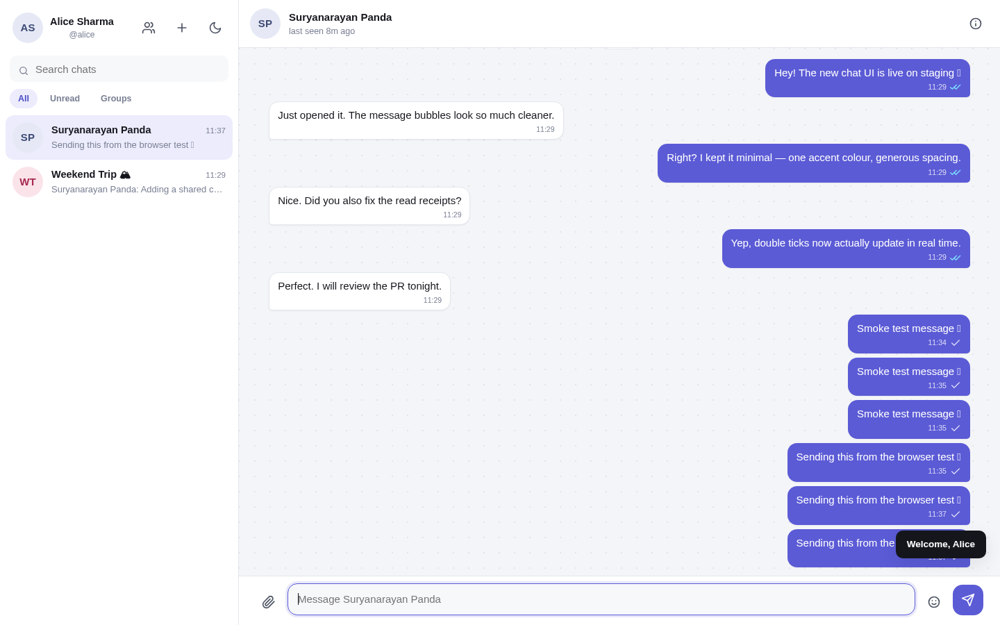
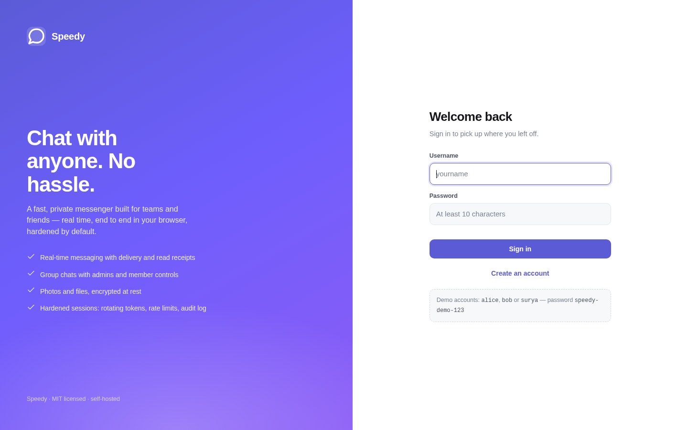
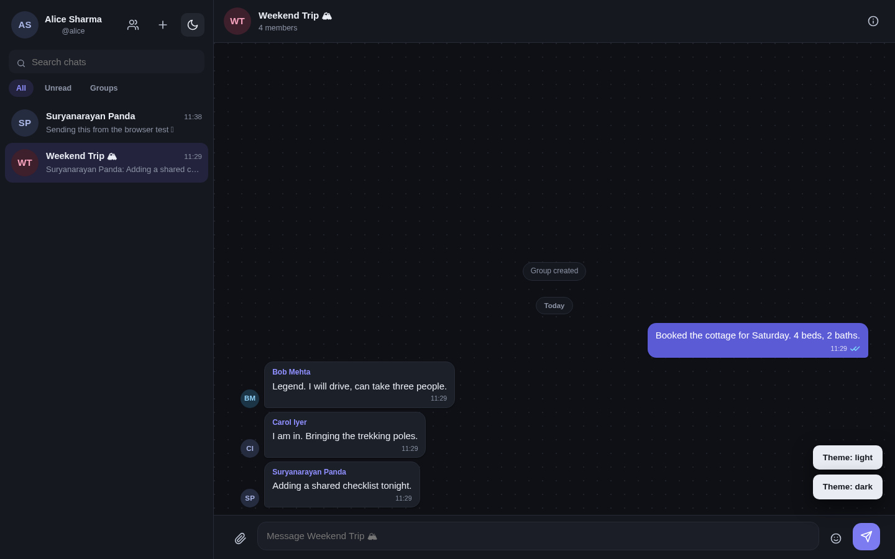

# Speedy — a production-ready chat app

A complete, self-hosted WhatsApp-style messenger: real-time 1:1 and group chat, media sharing,
delivery/read receipts, typing indicators, presence, reactions, edits and deletes — built with a
small, boring, well-understood stack and hardened with modern security defaults.



| Sign in | Dark theme | Mobile |
| --- | --- | --- |
|  |  |  |

---

## Features

**Messaging**
- Real-time 1:1 and group conversations over WebSockets (with automatic polling fallback)
- Message history with cursor pagination ("Load earlier messages")
- Delivery and read receipts (single tick, double tick, blue double tick)
- Typing indicators and online / last-seen presence
- Reply-to with quoted previews, emoji reactions, message editing, delete for everyone
- Image and file attachments (10 MB default), inline image previews, lightbox
- In-conversation message search
- Unread badges, per-chat mute, chat filters (All / Unread / Groups)

**Accounts & groups**
- Username + password accounts (no phone number, no email required)
- Profile: display name, about text, avatar upload
- Group chats with owner/admin/member roles, add/remove members, rename, leave
- Block users; blocked contacts cannot message you
- Session management UI: see every signed-in device and revoke any of them

**Product quality**
- Responsive layout (desktop 3-pane, mobile full-screen with slide transitions)
- Light / dark / follow-system themes, remembered per device
- Keyboard shortcuts (`Ctrl/⌘+K` search, `Ctrl/⌘+N` new chat, `Esc` closes panels)
- Accessible markup: focus states, ARIA labels, reduced-motion support
- Optimistic sending with retry, offline detection, graceful reconnection

## Tech stack

| Layer | Choice | Why |
| --- | --- | --- |
| Server | Node.js 20 + Express 4 | Ubiquitous, easy to audit, no build step |
| Realtime | Socket.IO 4 | Rooms, acks, reconnection, polling fallback |
| Database | SQLite via `@libsql/client` | Zero-ops, WAL mode, prepared statements, same API as Turso/libSQL if you outgrow a single node |
| Frontend | Vanilla ES modules + custom CSS | No bundler, no framework churn, ~40 KB of app code, instant load |
| Auth | JWT access tokens + rotating refresh cookies | Short-lived bearer tokens, revocable sessions |
| Validation | Zod | One schema per endpoint, shared error shape |
| Logging | Pino | Structured JSON, redacted secrets |

No TypeScript, no ORM, no CSS framework, no build pipeline. You can read every line.

## Quick start

```bash
git clone <your-fork-url> speedy && cd speedy
npm install
cp .env.example .env          # optional in development; secrets are generated for you
npm run seed                  # demo users + conversations (safe to skip)
npm start
```

Open <http://localhost:3000>.

Demo accounts created by `npm run seed` (password `speedy-demo-123`):
`alice`, `bob`, `carol`, `dev`, `surya`.

> Development mode writes generated secrets to `data/.dev-secrets.json` (mode 0600).
> In production the server refuses to boot unless `JWT_SECRET` and `MESSAGE_KEY` are set.

## Configuration

All configuration is environment variables (see `.env.example`).

| Variable | Default | Notes |
| --- | --- | --- |
| `NODE_ENV` | `development` | `production` enables HSTS, secure cookies, required secrets |
| `PORT` | `3000` | |
| `PUBLIC_ORIGIN` | `http://localhost:$PORT` | Used for CORS + CSRF origin checks and WebSocket CORS |
| `DATA_DIR` | `./data` | SQLite file, uploads, dev secrets |
| `UPLOAD_DIR` | `$DATA_DIR/uploads` | Attachments (outside the static root, served through an authorized route) |
| `JWT_SECRET` | generated in dev | **Required in production**, ≥ 32 chars |
| `MESSAGE_KEY` | generated in dev | **Required in production**, base64 of exactly 32 bytes |
| `ACCESS_TOKEN_TTL` | `900` | Access token lifetime in seconds |
| `REFRESH_TOKEN_TTL` | `2592000` | Refresh token lifetime in seconds (30 days) |
| `TRUST_PROXY` | `0` | Set to `1` behind nginx/Caddy/Cloudflare so `req.ip` and `secure` cookies work |
| `MAX_UPLOAD_BYTES` | `10485760` | Per-file upload limit |
| `LOG_LEVEL` | `info` (`debug` in dev) | Pino level |

## Security

The defaults are the safe ones, and every control here is deliberate:

- **Passwords**: scrypt (N=32768, r=8, p=1) with per-user salt, parameters embedded in the hash so
  they can be upgraded. Constant-time comparison. Dummy hashing on unknown users to defeat timing
  based account enumeration.
- **Sessions**: 15-minute JWT access tokens held in memory (never `localStorage`), plus opaque
  refresh tokens in `httpOnly`, `SameSite=Strict`, path-scoped cookies. Refresh tokens are stored
  only as SHA-256 hashes and **rotate on every use**; replaying a used token revokes the whole token
  family. Logout revokes server-side immediately.
- **Brute force**: per-IP rate limits on all auth endpoints, plus per-account lockout after 5 failed
  passwords. Every login, failure, lockout, token reuse and group-admin change goes to an audit log.
- **SQL injection**: 100% parameterized statements; no string concatenation of user input, no ORM
  escape hatches.
- **XSS**: no `innerHTML` for user content anywhere (text nodes only), strict CSP
  (`default-src 'self'`, no `unsafe-inline`, no `unsafe-eval`), `nosniff`, `X-Frame-Options: DENY`.
- **CSRF**: `SameSite=Strict` cookies, an `Origin`/`Sec-Fetch-Site` check on every write, and a
  double-submit token on the refresh endpoint.
- **Uploads**: never trust the client's `Content-Type` or filename — MIME is derived from magic
  bytes, names are stripped of path components and control characters, files get random names and
  are stored outside the web root, served only to chat members with
  `Content-Security-Policy: sandbox` and `Content-Disposition` set. Browser-facing
  URLs carry a short-lived HMAC signature bound to the viewer, so `` and
  download links work without weakening the authorization check.
- **Authorization**: every chat read/write checks membership; every message mutation checks
  authorship; every group action checks role. Covered by tests.
- **Data at rest**: message bodies and edits are AES-256-GCM encrypted in SQLite with a key from the
  environment, so a stolen database file does not leak conversations.
- **Realtime abuse**: per-socket token bucket (30 events / 10 s), payload size caps, socket auth
  re-validates the session on connect.
- **Operational**: request IDs on every response, structured redacted logs, graceful shutdown,
  health endpoint, non-root container, read-only root filesystem in the compose file.

Full threat model, control-by-control mapping and known limitations: **[docs/SECURITY.md](docs/SECURITY.md)**.

> **Honest note on encryption:** messages are encrypted **at rest and in transit**, but this is not
> end-to-end encryption — the server holds the key and can read message bodies. Real E2EE (Signal
> protocol, per-device keys, safety numbers) is a separate, much larger project; the UI copy and this
> README deliberately do not claim it.

## Project structure

```
.
├── server/
│   ├── src/
│   │   ├── index.js            # bootstrap: migrate, HTTP + Socket.IO, graceful shutdown
│   │   ├── app.js              # express wiring, static SPA, error handling
│   │   ├── config.js           # env parsing, secret management, limits
│   │   ├── db/                 # client, versioned schema, migrations, seed
│   │   ├── lib/                # crypto, password, tokens, dto, errors, files, audit, presence
│   │   ├── middleware/         # auth, security (helmet/CORS/CSRF/limits), errors, request id
│   │   ├── modules/            # auth, users, chats, messages, attachments (service + routes)
│   │   └── realtime/           # socket.io server + internal event bus
│   └── tests/api.test.js       # 14 API tests: auth, authz, receipts, uploads, CSRF, ...
├── public/
│   ├── index.html              # single page shell
│   ├── css/app.css             # design tokens, light/dark themes, responsive layout
│   └── js/                     # api, socket, store, dom helpers, ui/{auth,sidebar,chat,info,modals}
├── docs/                       # SECURITY.md, API.md, ARCHITECTURE.md, screenshots
├── Dockerfile / docker-compose.yml
└── .env.example
```

## API

REST for everything durable, WebSocket for everything live. Full reference: **[docs/API.md](docs/API.md)**.

```
POST   /api/auth/register            POST   /api/chats
POST   /api/auth/login               GET    /api/chats
POST   /api/auth/refresh             GET    /api/chats/:id
POST   /api/auth/logout              PATCH  /api/chats/:id
GET    /api/auth/me                  POST   /api/chats/:id/members
GET    /api/auth/sessions            DELETE /api/chats/:id/members/:userId
GET    /api/users/search             POST   /api/chats/:id/leave
PATCH  /api/users/me                 GET    /api/chats/:id/messages
POST   /api/users/:id/block          POST   /api/chats/:id/messages
POST   /api/attachments              GET    /api/chats/:id/search
GET    /api/attachments/:id          POST   /api/chats/:id/read
                                     PATCH  /api/messages/:id
                                     DELETE /api/messages/:id
                                     POST   /api/messages/:id/reactions
```

Socket events: `message:send`, `message:read`, `typing`, `chat:join` (client → server);
`message:new`, `message:updated`, `message:deleted`, `receipt:update`, `typing`, `presence`,
`chat:new`, `chat:updated` (server → client). Every client → server message is ack'd.

## Testing

```bash
npm test
```

14 end-to-end API tests run against a throwaway SQLite database in a temp directory — no mocks, no
external services. They cover registration and validation, duplicate usernames, generic login
failures, chat creation, encryption at rest, authorization on reads and writes, edit/delete
ownership, reactions, group roles, refresh-token rotation with reuse detection, CSRF enforcement,
logout revocation, upload sniffing and access control, read receipts, security headers, and the
404/SPA-fallback split.

## Deployment

### Docker

```bash
export JWT_SECRET=$(openssl rand -base64 48)
export MESSAGE_KEY=$(openssl rand -base64 32)
docker compose up -d --build
```

The container runs as a non-root user, drops all capabilities, has a read-only root filesystem with
a writable data volume, and ships a health check.

### Behind a reverse proxy

Terminate TLS at nginx/Caddy and set `TRUST_PROXY=1` and `PUBLIC_ORIGIN=https://chat.example.com`.
The app sets HSTS, secure cookies and `upgrade-insecure-requests` automatically in production.

```nginx
server {
  listen 443 ssl http2;
  server_name chat.example.com;

  client_max_body_size 12m;

  location / {
    proxy_pass http://127.0.0.1:3000;
    proxy_set_header Host $host;
    proxy_set_header X-Real-IP $remote_addr;
    proxy_set_header X-Forwarded-For $proxy_add_x_forwarded_for;
    proxy_set_header X-Forwarded-Proto $scheme;
  }

  location /socket.io/ {
    proxy_pass http://127.0.0.1:3000;
    proxy_http_version 1.1;
    proxy_set_header Upgrade $http_upgrade;
    proxy_set_header Connection "upgrade";
    proxy_set_header Host $host;
    proxy_read_timeout 600s;
  }
}
```

### Checking what is deployed

`GET /healthz` returns `{ status, version, uptime, env }`. The version comes from
`package.json`, so it is the quickest way to confirm which build is actually
running:

```bash
curl -s localhost:3000/healthz
# {"status":"ok","version":"1.0.1","uptime":42,"env":"production"}
```

### Backups

Everything lives in `DATA_DIR`: `speedy.db` (+ `-wal`/`-shm`) and `uploads/`. Use
`sqlite3 data/speedy.db ".backup backup.db"` for a consistent online snapshot, and copy `uploads/`
alongside it. Backups are still encrypted for message bodies, but treat them as sensitive — the
keys are in your environment.

## Known limitations

- **No end-to-end encryption** (see above). Server-side AES-256-GCM at rest + TLS in transit.
- **Single instance**: presence and socket rooms are in-process. Running more than one node needs a
  Redis adapter for Socket.IO and a shared presence store; the interfaces are isolated in
  `realtime/` and `lib/presence.js` to make that swap small. libSQL also lets you point `db` at a
  remote Turso database if you outgrow local SQLite.
- **Search** decrypts a bounded window of recent messages per chat (400) instead of using SQL `LIKE`,
  because bodies are encrypted. Fine for chat-sized histories; use a dedicated index if you need to
  search years of messages.
- **No push notifications**: the app is browser-first; background delivery needs a service worker and
  a push service (VAPID), which is deliberately out of scope.
- **No email/phone verification or password reset**: accounts are username + password only. Add an
  email provider and a signed reset-token table if you need them.

## License

Apache-2.0. See [LICENSE](LICENSE).
